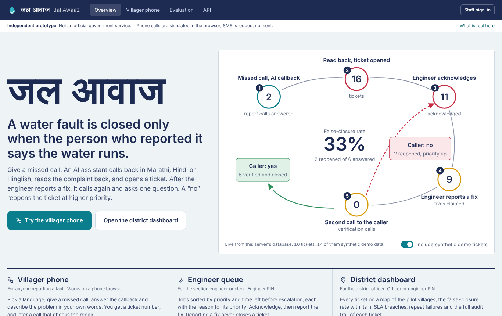
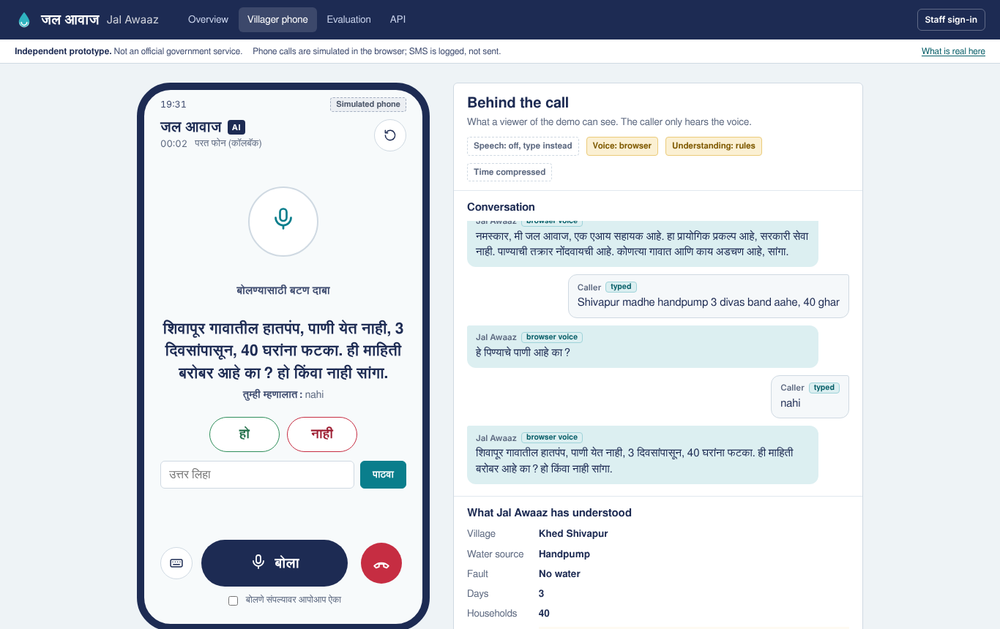
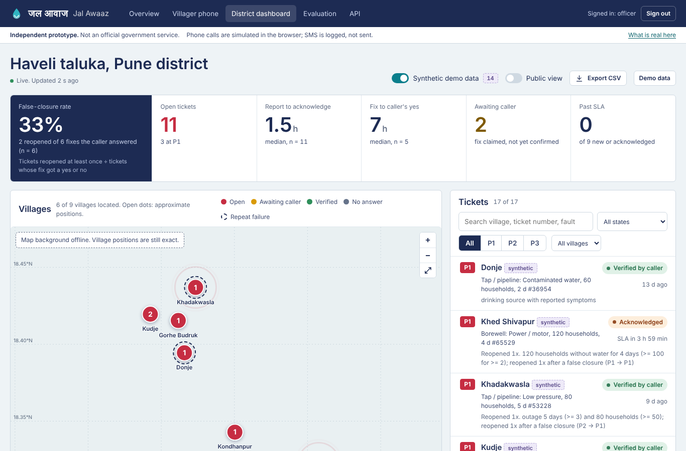
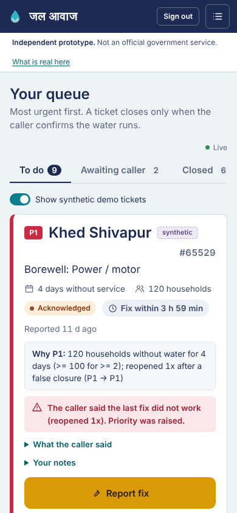
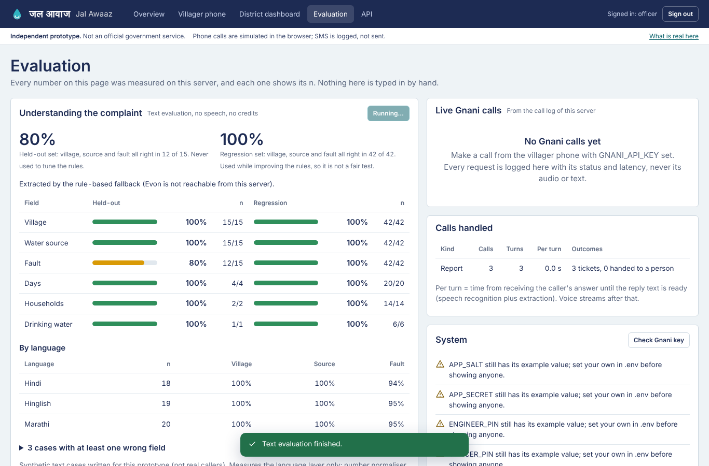

# Jal Awaaz (जल आवाज)

**Report a broken water source by voice. Close it only when the person who reported it says the water runs.**

A villager gives a missed call. An AI assistant calls back in Marathi, Hindi or Hinglish, says it is an
AI, asks about the fault one question at a time, reads the complaint back and opens a ticket only after
the caller says yes. The engineer acknowledges the ticket and reports a fix. Reporting a fix never
closes a ticket: the assistant calls the original caller again and asks whether the water is running.
"Yes" verifies and closes. "No" reopens the ticket at a higher priority, and the district dashboard's
headline number, the **false-closure rate**, moves.

**One-page pitch: [PITCH.pdf](PITCH.pdf) ([text version](PITCH.md)) · Demo video: VIDEO_LINK**

> Independent prototype, not an official government service. The phone calls in this demo are simulated
> in the browser (the speech, language and ticket pipeline is real). SMS messages are logged, not sent.
> Built with AI assistance.



## What is in the box

| Screen | Who | What it does |
|---|---|---|
| `/phone` | Villager | Missed call, ringing callback, voice conversation with live captions, ticket number, later a verification call. Marathi, Hindi or Hinglish. Works on a phone browser. |
| `/engineer` | Section engineer | Queue sorted by priority and SLA, the reason for every priority, one-tap acknowledge, "Report fix" that explains it does not close the ticket. |
| `/dashboard` | District officer | Map of the pilot villages, false-closure rate with its n, SLA breaches, repeat failures, 14-day trend, audit trail of every ticket, CSV export, public view. |
| `/metrics` | Anyone | Measured evaluation (with n), live Gnani latency, call outcomes, system status. |
| `/docs` | Developers | API reference generated from `app/openapi.py`. |

|  |  |
|---|---|
|  |  |

## Quick start

You need Python 3.10 or newer. ffmpeg is bundled through `imageio-ffmpeg` if it is not already installed.

**Windows (PowerShell or cmd), from the `jalawaaz` folder:**

```bat
python -m venv ..\.venv
..\.venv\Scripts\activate
run.bat install          REM pip install -r requirements-dev.txt
copy .env.example .env   REM then open .env and paste your Gnani key
run.bat doctor           REM checks everything and says how to fix problems
run.bat seed             REM optional: 14 labelled synthetic tickets for the dashboard
run.bat                  REM starts the server on http://localhost:8000
```

**macOS / Linux:**

```bash
python3 -m venv .venv && source .venv/bin/activate
make install && cp .env.example .env     # add your Gnani key to .env
make doctor && make seed && make run
```

Open <http://localhost:8000>. Staff PINs are in `.env` (demo values: engineer `2468`, officer `1357`; the
sign-in page shows them only while they are unchanged). Phone microphones need HTTPS, so to use a real
phone run `cloudflared tunnel --url http://localhost:8000` (or `run.bat tunnel`) and open the printed
address on the phone. Never put real villager data through a public tunnel.

Without a Gnani key the whole demo still runs: callers type their answers, replies use the browser's
voice, and every screen says so.

## The five-act demo

1. **Phone, missed call.** Open `/phone`, pick a language, tap the call button. The callback rings a few seconds later.
2. **Phone, report.** Answer. The assistant says it is an AI. Speak (for example *"Shivapur madhe handpump 3 divas band aahe, 40 ghar"*), hear the read-back, say *"ho"*. You get a five-digit ticket number.
3. **Laptop, dashboard.** A red pin appears on the village with the priority and the reason for it.
4. **Laptop, engineer.** Acknowledge, then Report fix. The pin turns haldi yellow ("awaiting caller").
5. **Phone, verification.** The phone rings again. *"Ho"* verifies the ticket (green). Run it again and answer *"nahi"*: the ticket reopens at a higher priority and the false-closure rate changes.

Timings are compressed in demo mode (`DEMO_MODE=1`); say "time compressed" in any video. The full runbook,
with a pre-demo checklist and troubleshooting, is in [docs/RUNBOOK.md](docs/RUNBOOK.md).

## What is real and what is simulated

| Part | Status |
|---|---|
| Speech to text | **Real** Gnani Prisma v3.0 when `GNANI_API_KEY` is set, with keyterms, topic and previous-question context. Otherwise typed answers. |
| Spoken replies | **Real** Gnani Timbre v3.0, MP3 streamed over SSE (first audio plays before synthesis finishes). Otherwise the browser voice, labelled. |
| Understanding the complaint | Evon v3.3 on **your own** OpenAI-compatible server when reachable; otherwise a rule-based extractor. The UI says which ran. |
| Priority, SLA, escalation, closure | **Real**, deterministic Python. No model sets priority or closes a ticket. |
| Phone calls | **Simulated**: the browser page plays the phone; the callback and verification call are queued by the server and ring the page. |
| SMS | **Simulated**: written to the SMS log and shown on the dashboard. |
| Tickets on the dashboard | Real tickets from calls, plus optional synthetic demo tickets that carry a "synthetic" label everywhere and can be hidden or removed. |
| Village positions | 6 of 9 villages have coordinates with a cited source (2 cited, 4 marked approximate). The others are listed as not on the map; no coordinate is invented. |

## Measured results (this repository, no credits)

`python -m bench.text_eval` (or "Run now" on `/metrics`) runs the language layer on synthetic text cases.
Rule-based extractor, 2026-11-13:

| Set | Cases | Village, source and fault all right |
|---|---|---|
| Held-out (never used to tune the rules) | 15 | 12 (80%) |
| Regression (used while improving the rules) | 42 | 42 (100%, not a fair test) |

The three held-out misses are listed on `/metrics` and in `CHANGELOG.md`. Speech accuracy on real or
noisy audio is **not measured yet**: record clips and run `python -m bench.run_bench` (docs/TESTING.md).
No pilot with real callers has been run. Do not quote any other number.

## How it works

```
Phone page ──audio──► /api/turn ──► ffmpeg (16 kHz WAV, or 8 kHz mu-law line in telephone mode)
                                     └► Prisma v3.0 (language hint, keyterms, topic, previous question)
                                          └► state machine ── extraction (Evon or rules) ── validators ── gazetteer
                                               └► read-back template ─► reply text returned immediately
Phone page ◄── MP3 streamed from /api/speech/<id> ◄── Timbre SSE (falls back to REST)
Caller says yes ─► ticket (priority rules in code) ─► engineer SMS (logged) ─► dashboard
Engineer "Report fix" ─► scheduler queues a verification call (never in quiet hours in real mode)
Caller yes ─► VERIFIED      Caller no ─► REOPENED ─► back to engineer, priority +1      3 unanswered ─► UNVERIFIED
```

More: [docs/ARCHITECTURE.md](docs/ARCHITECTURE.md) (diagrams, state machines, data model),
[docs/GNANI_INTEGRATION.md](docs/GNANI_INTEGRATION.md) (every Gnani field we send and why).

## Project layout

```
app/
  main.py               HTTP routes (Starlette)            openapi.py    API description for /docs
  config.py             .env + data/config.json            db.py         SQLite schema, migrations, audit
  audio.py              ffmpeg conversion, mu-law decode   security.py   hashing, PINs, rate limit
  gnani/                Prisma, Timbre (REST + SSE), Evon adapters, voice catalogue, shared client
  nlp/                  numbers (parse), spoken (say), gazetteer, yes/no, extraction
  core/                 state machine, templates, priority, validators, tickets, scheduler, SMS
  services/             pipeline (one call turn), speech store, evaluation, demo data
web/                    pages (HTML) + assets/ (app.css, app.js, map.js, phone.js, dashboard.js, engineer.js)
data/                   villages.csv (gazetteer with coordinate sources), config.json (thresholds)
bench/                  text cases, audio benchmark, noise and phone-line simulation, reports
scripts/                doctor, smoke (live Gnani check), warm_tts, seed_demo
tests/                  unit, API and browser (tests/e2e) tests
docs/                   everything else (index below)
```

## Testing

```bash
python -m pytest -q --ignore=tests/e2e     # 317 tests, about 5 s, no network, no credits
python -m pytest -q tests/e2e              # the five-act demo in headless Chromium (needs playwright)
python -m scripts.smoke                    # ~8 real Gnani requests: key, Timbre file/stream/phone line, Prisma with and without context
```

## Documentation

| Document | For |
|---|---|
| [PITCH.pdf](PITCH.pdf) / [PITCH.md](PITCH.md) | The one-page pitch |
| [docs/RUNBOOK.md](docs/RUNBOOK.md) | Setting up, running the demo, troubleshooting |
| [docs/USER_GUIDE.md](docs/USER_GUIDE.md) | Villagers, engineers and officers: what each screen does |
| [docs/ARCHITECTURE.md](docs/ARCHITECTURE.md) | Components, data flow, state machines, data model |
| [docs/API.md](docs/API.md) | Every endpoint with examples (also live at `/docs`) |
| [docs/GNANI_INTEGRATION.md](docs/GNANI_INTEGRATION.md) | Prisma, Timbre, Evon: fields, voices, errors, what changed in the 2026 APIs |
| [docs/CONFIGURATION.md](docs/CONFIGURATION.md) | Every `.env` setting and `data/config.json` threshold |
| [docs/PRIVACY_SECURITY.md](docs/PRIVACY_SECURITY.md) | What is stored, hashing, retention, auth, threats |
| [docs/TESTING.md](docs/TESTING.md) | Test suites, evaluation, benchmark, native-speaker checklist |
| [docs/DESIGN.md](docs/DESIGN.md) | The visual design system |
| [docs/decisions.md](docs/decisions.md) | Every design decision and why |
| [docs/costs.md](docs/costs.md) | How to measure Gnani credits per report |
| [docs/HACKATHON_SUBMISSION_GUIDE.md](docs/HACKATHON_SUBMISSION_GUIDE.md) | Challenge submission: deadline, form fields, publishing, evidence |
| [docs/VIDEO_SCRIPT_AND_PITCH.md](docs/VIDEO_SCRIPT_AND_PITCH.md) | The demo videos, the voiced take, the LinkedIn and X post |
| [scripts/demo_video/README.md](scripts/demo_video/README.md) | How the demo video is recorded from the running app |
| [CHANGELOG.md](CHANGELOG.md) | What changed in each version |
| [docs/SPEC.md](docs/SPEC.md) | The original build specification |

## Limits

- No real telephony: Path C (browser phone) of the spec runs. A telephony provider can reuse the same pipeline.
- Speech accuracy, Timbre pronunciation of village names and every Marathi/Hindi sentence still need a native-speaker review (checklist in docs/TESTING.md).
- Priority thresholds in `data/config.json` are assumptions to review with a Jal Mitra or engineer.
- Verification answers can be polite rather than true (acquiescence bias); treat them as a measured signal, not proof.
- The audit trail and false-closure rate are only as good as the number of verification calls answered; the dashboard always shows n.
