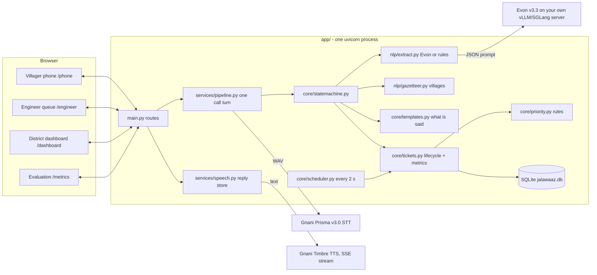
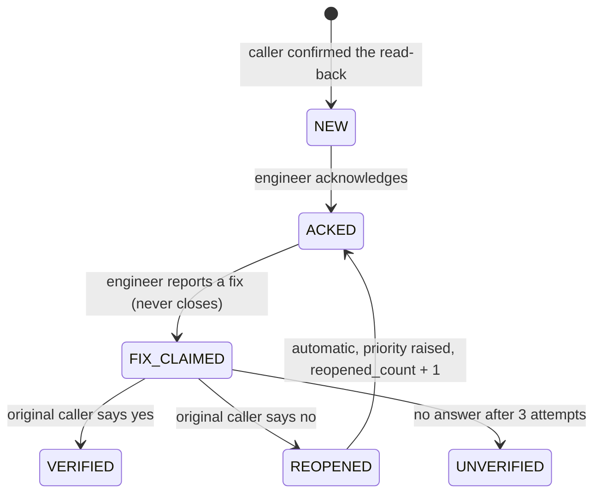

# Architecture

Jal Awaaz is one Python process (Starlette on uvicorn) with an SQLite database, a background scheduler,
and plain HTML/CSS/JavaScript pages. Models only hear, extract and speak; code decides everything else.

## Components



| Layer | Files | Rule |
|---|---|---|
| HTTP | `app/main.py`, `app/openapi.py` | Thin. Validation (Pydantic), auth, CSRF, rate limit, error envelope, security headers. |
| Call pipeline | `app/services/pipeline.py`, `app/services/speech.py` | Audio in, reply text out at once, voice streamed separately. |
| Conversation | `app/core/statemachine.py`, `app/core/templates.py` | One question per turn, read-back before any ticket, AI disclosed first. |
| Language | `app/nlp/*` | Number normaliser, spoken numbers, gazetteer, yes/no, extraction with anti-hallucination guards. |
| Decisions | `app/core/priority.py`, `tickets.py`, `scheduler.py`, `validators.py` | Deterministic code. Database trigger blocks illegal state changes. |
| Vendors | `app/gnani/*` | Prisma, Timbre, Evon behind small interfaces (`base.py`); tests swap in fakes. |

## One turn of a call

```mermaid
sequenceDiagram
  participant Phone as Phone page
  participant API as /api/turn
  participant Prisma
  participant SM as State machine
  participant Speech as /api/speech
  participant Timbre
  Phone->>API: audio (webm/mp4, max 25 s) + session id
  API->>API: ffmpeg -> 16 kHz mono WAV (8 kHz mu-law round trip in telephone mode)
  API->>API: silence check (no credit spent on silence)
  API->>Prisma: WAV, language hint, keyterms, topic, previous question
  Prisma-->>API: transcript, detected language
  API->>SM: transcript
  SM->>SM: normalise numbers, extract fields (Evon or rules), validate, match village
  SM-->>API: next question or read-back (caption + speech text)
  API-->>Phone: reply text, audio_url, fields so far, timings
  Phone->>Speech: GET audio_url
  Speech->>Timbre: SSE request (MP3)
  Timbre-->>Speech: base64 chunks
  Speech-->>Phone: MP3 bytes as they arrive (audio starts playing)
  Phone->>Phone: after playback the mic opens; it closes when the caller pauses
```

The caller's audio exists only in memory and a temporary folder that is deleted after transcription.
The reply audio for a turn is kept in memory for three minutes so "play again" costs nothing; fixed
template sentences are cached on disk (`tts_cache/`), sentences with caller details never are.

## Call state machine (`core/statemachine.py`)

```mermaid
stateDiagram-v2
  [*] --> GREET: callback answered (AI disclosed)
  GREET --> COLLECT: caller speaks
  COLLECT --> COLLECT: one question per turn (required: village, source, fault; up to 3 optional)
  COLLECT --> VILLAGE_CONFIRM: village match 70-88
  VILLAGE_CONFIRM --> COLLECT: yes / no (asks again once)
  COLLECT --> CONFIRM: read-back template
  CONFIRM --> CLOSE: yes -> ticket number spoken twice, digit by digit
  CONFIRM --> CORRECTION: no (once)
  CORRECTION --> COLLECT
  CONFIRM --> HANDOFF: unclear twice or second no
  COLLECT --> HANDOFF: silence twice, unknown village twice, or question budget spent without required fields
  [*] --> VERIFY: verification call answered
  VERIFY --> VERIFY_DONE: yes / no / unclear twice
```



## Ticket lifecycle (`core/tickets.py`, enforced again by a database trigger)



Only these transitions exist. `db.py` installs a trigger that aborts any other `UPDATE tickets SET state`,
so even a bug elsewhere cannot close a ticket. Every change is written to `ticket_events` (audit trail).

## Scheduler (`core/scheduler.py`, every 2 seconds)

1. **Verification calls.** `FIX_CLAIMED` tickets whose `next_verify_at` has passed get a `verification`
   row in `outbox` for the original caller's device hash; attempts + 1; retry later. After 3 attempts with
   no yes/no the ticket becomes `UNVERIFIED`. Real mode never calls between 21:00 and 07:00 IST.
2. **SLA escalation.** `NEW`/`ACKED` tickets older than the SLA for their priority move up one level
   (P1 4 h, P2 24 h, P3 72 h by default). A P1 past its SLA is recorded as `sla_breach_p1`.
3. **Retention.** Transcripts older than 90 days are erased; fields and the audit trail remain.

## Priority (`core/priority.py`)

| Rule (thresholds in `data/config.json`) | Priority |
|---|---|
| Drinking source and (symptoms or contamination), or contamination with symptoms | P1 |
| Handpump/tap/well/tank/borewell, ≥100 households, ≥2 days | P1 |
| ≥3 days or ≥50 households | P2 |
| Repeat report on the same village and source within 30 days | P2 |
| Reopened after a false closure | one level higher per reopen, never lower than before |
| Otherwise | P3 |

Every ticket stores the reason string, and every screen shows it.

## Data model (SQLite)

| Table | Holds | Personal data |
|---|---|---|
| `villages` | gazetteer: name, spelling variants, taluka, district, lat/lon, coordinate source and quality | none |
| `reports` | extracted fields, transcript (90-day retention), evidence quote, extraction source | caller hash only |
| `tickets` | ref, state, priority + reason, timestamps, attempts, notes | caller hash only |
| `ticket_events` | audit trail of every change | none |
| `verifications` | each verification answer (yes/no/none) | none |
| `calls` | per call: turns, latencies, providers used, outcome | caller hash |
| `api_calls` | every Gnani/Evon request: service, model, status, latency, request id | none |
| `outbox` | simulated callbacks and verification calls waiting for the phone | device hash |
| `sms_log` | simulated SMS text | ticket ref only |

Phone numbers and device ids are stored only as salted HMAC-SHA256 hashes (`security.hash_id`).
`init_db()` creates missing tables and adds missing columns, so an older `jalawaaz.db` upgrades in place.

## Front end

No framework and no build step. `web/assets/app.js` holds shared helpers (safe DOM builder that never
injects caller text as HTML, API client with CSRF header, toasts, IST time formatting, labels in English,
Marathi and Hindi). `map.js` is a small Web Mercator map (OpenStreetMap tiles when online, an offline
graticule that keeps positions exact when not). Pages poll the API every 2–3 seconds and pause when the
tab is hidden. See [DESIGN.md](DESIGN.md) for the visual system.

## Moving to real telephony

Only the transport changes. A telephony webhook (Exotel, Twilio, or Gnani Agent Builder for whitelisted
numbers) would call the same `pipeline.start_session` / `run_turn` with 8 kHz audio, set
`TTS_TELEPHONE_CONTAINER=mulaw`, and play Timbre's mu-law reply directly instead of the browser. The
outbox rows become real outbound calls. See SPEC.md section 2.4 for the paths.
